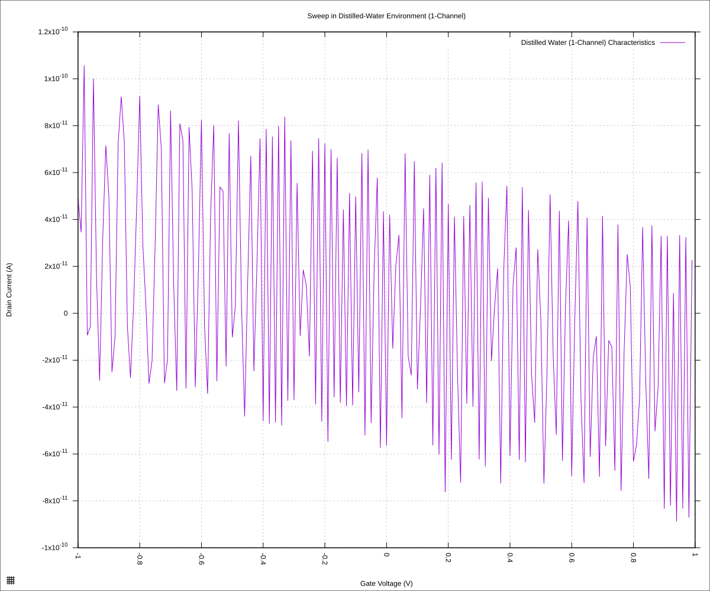
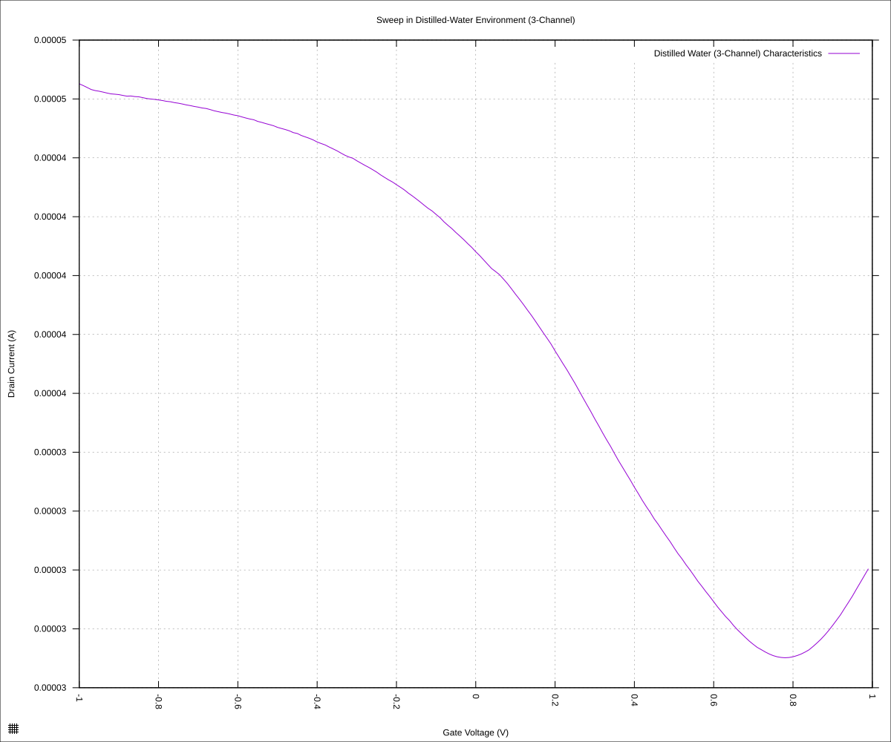
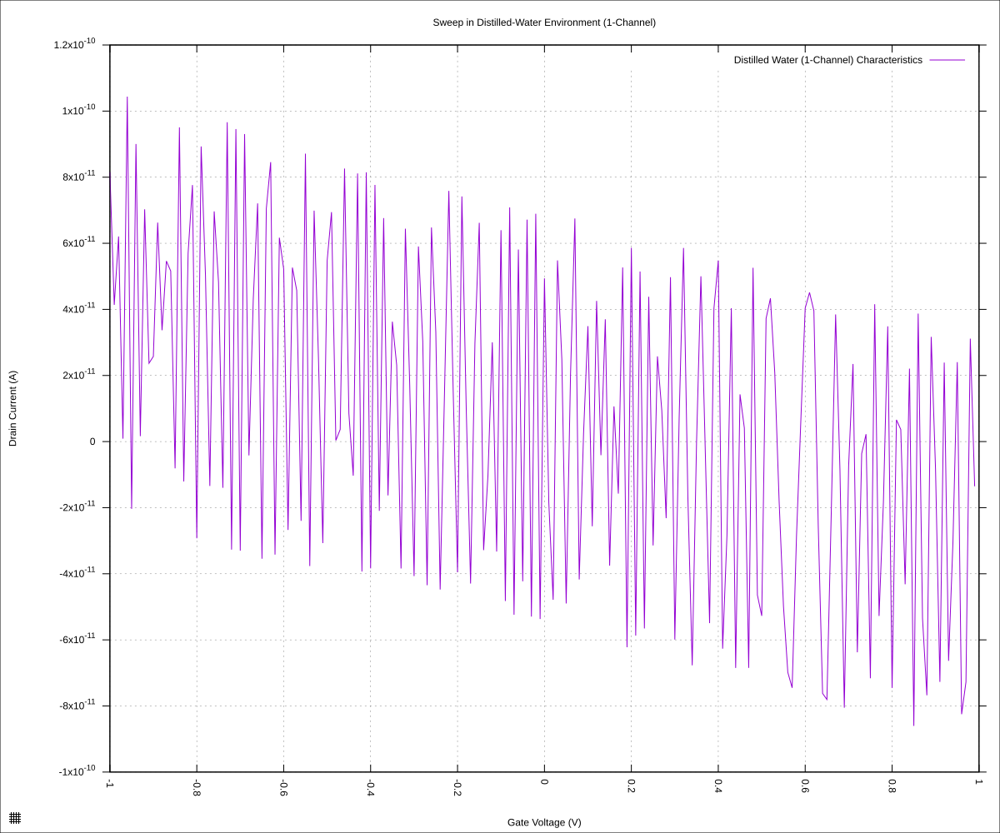
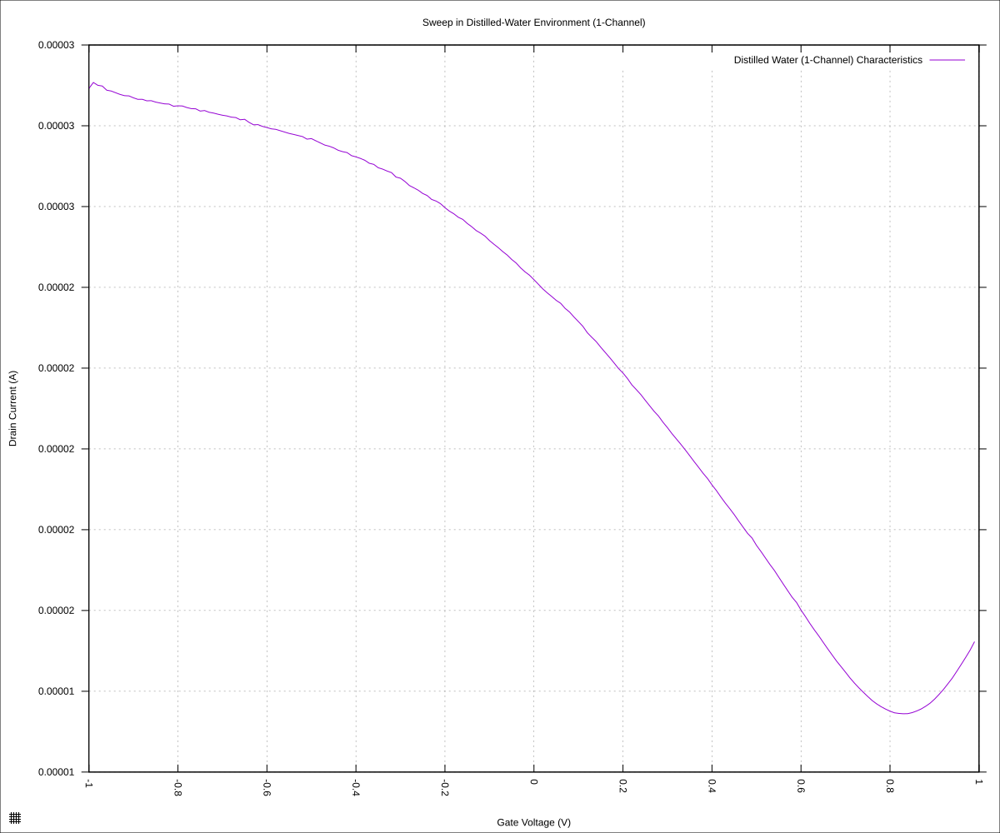
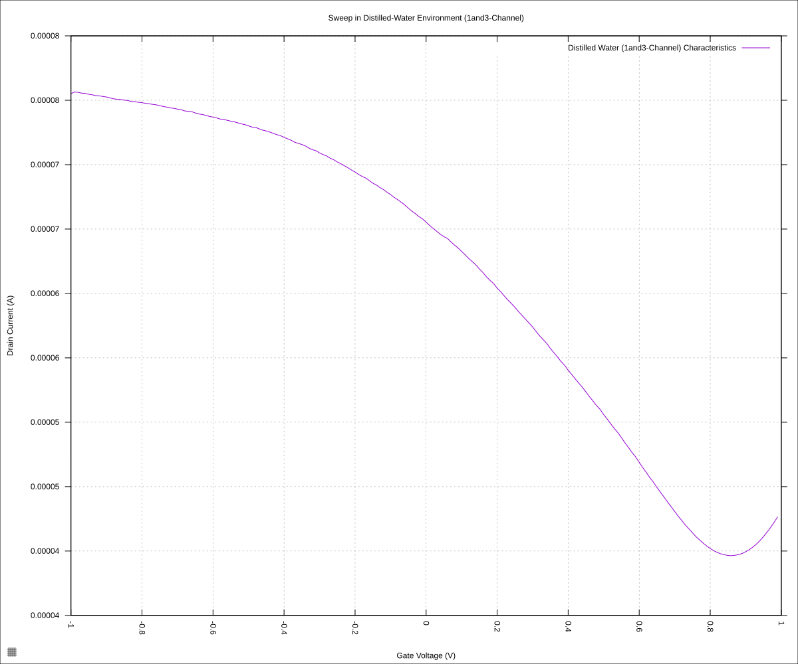
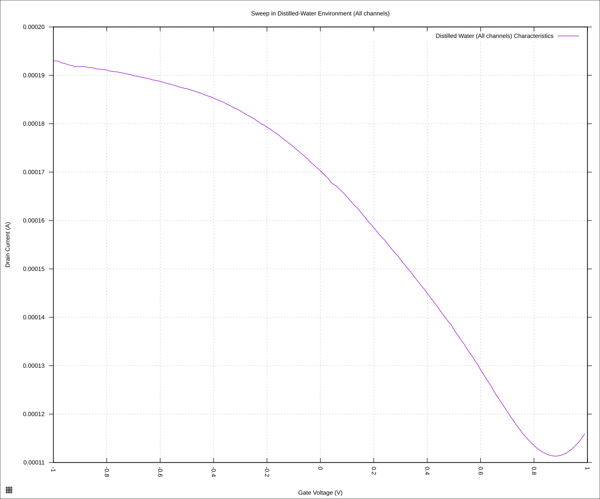

#+STARTUP: content
#+TITLE: Progress Report and Updates: 2026-10-06
#+AUTHOR: Frederick Muriuki Muriithi
#+PROPERTY: header-args:shell
#+LATEX_HEADER_EXTRA: \usepackage{svg}
#+BIBLIOGRAPHY: references.bib
#+CITE_EXPORT: natbib kluwer
#+LATEX_HEADER_EXTRA: \usepackage{fontspec}
#+LATEX: \setmainfont{Liberation Serif}
#+AUTO_TANGLE: t
#+OPTIONS: ^:{}

* Integrations

** Goals and Setup

*** Goals

- [X] Do a scan with a single-channel GFET
- [X] Do a scan with a 3-channel GFET
- [X] Do a scan with both a 1-channel GFET and 3-channel GFET at the same time
- [X] Do a scan with *ALL* GFETs turned on
- [X] Clean chips

*** Setup

- [X] Turn on SMU
  - SMU was already turned on since yesterday, therefore it is settled and we
    can go straight to measurements.
- [X] Connect SMU to computer
- [X] Take out chip from vacuum storage and load on to Graphenea card
  - [X] Verify orientation
  - [X] Verify orientation again
- [X] Dispense a 10µL drop of pure distilled water on the chip's active area
- [X] Turn on global switches to Gate, Drain and Sources
- [X] Ensure *ALL* of the switches to specific sources are turned *OFF*
  - [X] Verify one more time for good measure
- [X] Setup results directory
  #+begin_src shell
    mkdir -pv "fd-test-01/$(date +'%Y%m%d')"
  #+end_src

The setup is complete!

** 1-channel GFET

- [X] Ensure *ALL* of the switches to specific sources are turned *OFF*
  - [X] Verify one more time for good measure
- [X] Turn on switch 01 on the bank of switches to single channel devices
- [X] Run scan
  #+begin_src shell
    python3 sweep.py \
            --raise-keithley-errors \
            --smu-visa-address ASRL/dev/ttyUSB0::INSTR \
            --line-frequency 60 \
            --nplc 12.5005 \
            --gate_voltage 1 \
            --sweep_interval 0.01\
            --channel-voltage 0.05 \
            > \
            "fd-test-01/$(date +'%Y%m%d')/$(date +'%Y%m%d')-00-single-channel.csv" \
            2> \
            "fd-test-01/$(date +'%Y%m%d')/$(date +'%Y%m%d')-00-single-channel.csv" && \
        python3 isswisafre.py process-data \
                "fd-test-01/$(date +'%Y%m%d')/$(date +'%Y%m%d')-00-single-channel.csv" \
                "fd-test-01/$(date +'%Y%m%d')/"
  #+end_src
- [X] Turn off switch 01 on the bank of switches to single channel devices

** 3-Channel GFET

- [X] Ensure *ALL* of the switches to specific sources are turned *OFF*
  - [X] Verify one more time for good measure
- [X] Turn on switch 01 on the bank of switches to 3-channel devices
- [X] Run scan
  #+begin_src shell
    python3 sweep.py \
            --raise-keithley-errors \
            --smu-visa-address ASRL/dev/ttyUSB0::INSTR \
            --line-frequency 60 \
            --nplc 12.5005 \
            --gate_voltage 1 \
            --sweep_interval 0.01\
            --channel-voltage 0.05 \
            > \
            "fd-test-01/$(date +'%Y%m%d')/$(date +'%Y%m%d')-01-three-channel.csv" \
            2> \
            "fd-test-01/$(date +'%Y%m%d')/$(date +'%Y%m%d')-01-three-channel.csv" && \
        python3 isswisafre.py process-data \
                "fd-test-01/$(date +'%Y%m%d')/$(date +'%Y%m%d')-01-three-channel.csv" \
                "fd-test-01/$(date +'%Y%m%d')/"
  #+end_src
- [X] Turn off switch 01 on the bank of switches to 3-channel devices

** 1-Channel and 3-Channel GFETs

- [X] Ensure *ALL* of the switches to specific sources are turned *OFF*
  - [X] Verify one more time for good measure
- [X] Turn on switch 02 to the 1-channel bank devices and switch 01 to the
  3-channel bank devices
- [X] Run scan
  #+begin_src shell
    python3 sweep.py \
            --raise-keithley-errors \
            --smu-visa-address ASRL/dev/ttyUSB0::INSTR \
            --line-frequency 60 \
            --nplc 12.5005 \
            --gate_voltage 1 \
            --sweep_interval 0.01\
            --channel-voltage 0.05 \
            > \
            "fd-test-01/$(date +'%Y%m%d')/$(date +'%Y%m%d')-02-one-and-three-channel.csv" \
            2> \
            "fd-test-01/$(date +'%Y%m%d')/$(date +'%Y%m%d')-02-one-and-three-channel.csv" && \
        python3 isswisafre.py process-data \
                "fd-test-01/$(date +'%Y%m%d')/$(date +'%Y%m%d')-02-one-and-three-channel.csv" \
                "fd-test-01/$(date +'%Y%m%d')/"
  #+end_src
- [X] Turn off switch 02 to the 1-channel bank devices and switch 01 to the
  3-channel bank devices

** ALL GFETs

- [X] Ensure *ALL* of the switches to specific sources are turned *OFF*
  - [X] Verify one more time for good measure
- [X] Turn on all switches to all GFETS on the chip
- [X] Run scan
  #+begin_src shell
    python3 sweep.py \
            --raise-keithley-errors \
            --smu-visa-address ASRL/dev/ttyUSB0::INSTR \
            --line-frequency 60 \
            --nplc 12.5005 \
            --gate_voltage 1 \
            --sweep_interval 0.01\
            --channel-voltage 0.05 \
            > \
            "fd-test-01/$(date +'%Y%m%d')/$(date +'%Y%m%d')-03-all-gfets.csv" \
            2> \
            "fd-test-01/$(date +'%Y%m%d')/$(date +'%Y%m%d')-03-all-gfets.csv" && \
        python3 isswisafre.py process-data \
                "fd-test-01/$(date +'%Y%m%d')/$(date +'%Y%m%d')-03-all-gfets.csv" \
                "fd-test-01/$(date +'%Y%m%d')/"
  #+end_src
- [X] Turn off all switches to all GFETS on the chip

** Cleanup

- [X] Put chip(s) in 10ml beakers
- [X] Dispense 3mL of acetone to ensure chip is submerged
- [X] Leave chip submerged overnight

** Results & Conclusions

*** Results

We generate the plot for the scan with the 1-channel device only

#+begin_src gnuplot :tangle ./20261006-00-single-channel.gp
  load "./20260220-plotting-styles.gp"

  set output "./static/20261006-00-single-channel.svg"

  set title "Sweep in Distilled-Water Environment (1-Channel)"
  set xlabel "Gate Voltage (V)"
  set ylabel "Drain Current (A)"
  set datafile separator ","
  plot \
       "./static/20261006-00-single-channel-positive.csv" \
       using "measured_gate_voltage":"drain_current" \
       title "Distilled Water (1-Channel) Characteristics" \
       with lines
#+end_src

which gives us the plot:

#+CAPTION: Sweep in ultrapure distilled water, with the 1-Channel GFET device
#+NAME: 20261006-00-single-channel

This is just noise. Looks like something went terribly wrong.

On the other hand, the 3-channel device only plot becomes

#+begin_src gnuplot :tangle ./20261006-01-three-channel.gp
  load "./20260220-plotting-styles.gp"

  set output "./static/20261006-01-three-channel.svg"

  set title "Sweep in Distilled-Water Environment (3-Channel)"
  set xlabel "Gate Voltage (V)"
  set ylabel "Drain Current (A)"
  set datafile separator ","
  plot \
       "./static/20261006-01-three-channel-positive.csv" \
       using "measured_gate_voltage":"drain_current" \
       title "Distilled Water (3-Channel) Characteristics" \
       with lines
#+end_src

This gives us this clean smooth curve

#+CAPTION: Sweep in ultrapure distilled water, with the 3-Channel GFET device
#+NAME: 20261006-01-three-channel

This implies the first attempt sweep with the 1-channel device might have had connection issues -- maybe the switch did not connect correctly?

Let us try the sweep with a single channel again:

#+begin_src gnuplot :tangle ./20261006-04-single-channel.gp
  load "./20260220-plotting-styles.gp"

  set output "./static/20261006-04-single-channel.svg"

  set title "Sweep in Distilled-Water Environment (1-Channel)"
  set xlabel "Gate Voltage (V)"
  set ylabel "Drain Current (A)"
  set datafile separator ","
  plot \
       "./static/20261006-04-single-channel-positive.csv" \
       using "measured_gate_voltage":"drain_current" \
       title "Distilled Water (1-Channel) Characteristics" \
       with lines
#+end_src

... and we still get noise:

Let's try a different switch, say switch-02

#+begin_src gnuplot :tangle ./20261006-05-single-channel.gp
  load "./20260220-plotting-styles.gp"

  set output "./static/20261006-05-single-channel.svg"

  set title "Sweep in Distilled-Water Environment (1-Channel)"
  set xlabel "Gate Voltage (V)"
  set ylabel "Drain Current (A)"
  set datafile separator ","
  plot \
       "./static/20261006-05-single-channel-positive.csv" \
       using "measured_gate_voltage":"drain_current" \
       title "Distilled Water (1-Channel) Characteristics" \
       with lines
#+end_src

#+CAPTION: Sweep in ultrapure distilled water, with the 1-Channel GFET device (Try 03)
#+NAME: 20261006-05-single-channel

Ahh, looks like there might be a connection issue with that specific GFET.

We can now proceed to the combination of the 1-channel and 3-channel device results.

#+begin_src gnuplot :tangle ./20261006-02-one-and-three-channel.gp
  load "./20260220-plotting-styles.gp"

  set output "./static/20261006-02-one-and-three-channel.svg"

  set title "Sweep in Distilled-Water Environment (1and3-Channel)"
  set xlabel "Gate Voltage (V)"
  set ylabel "Drain Current (A)"
  set datafile separator ","
  plot \
       "./static/20261006-02-one-and-three-channel-positive.csv" \
       using "measured_gate_voltage":"drain_current" \
       title "Distilled Water (1and3-Channel) Characteristics" \
       with lines
#+end_src

which gives us the plot:

#+CAPTION: Sweep in ultrapure distilled water, with both a 1-Channel GFET device and a 3-channel GFET device
#+NAME: 20261006-02-one-and-three-channel

Now we can proceed to running the sweep with all (or as many as possible) GFET devices connected.

All the switches were turned on, except switch 01 in the 1-channel bank.

#+begin_src gnuplot :tangle ./20261006-03-all-gfets.gp
  load "./20260220-plotting-styles.gp"

  set output "./static/20261006-03-all-gfets.svg"

  set title "Sweep in Distilled-Water Environment (All channels)"
  set xlabel "Gate Voltage (V)"
  set ylabel "Drain Current (A)"
  set datafile separator ","
  plot \
       "./static/20261006-03-all-gfets-positive.csv" \
       using "measured_gate_voltage":"drain_current" \
       title "Distilled Water (All channels) Characteristics" \
       with lines
#+end_src

This gives us the following plot

#+CAPTION: Sweep in ultrapure distilled water, with both all but one GFETs.
#+NAME: 20261006-03-all-gfets

*** Conclusions

- The 1-channel only plot shows the dirac point at around +0.85V with a
  Drain-Source current (I_{DS}) of around 10µA.
- The 3-channel only plot shows the dirac point at around +0.77V with a
  Drain-Source current (I_{DS}) of around 30µA
- The (1 and 3)-channel plot shows the dirac point at around +0.85V with a
  Drain-Source current (I_{DS}) of around 40µA
- The "All"-channel plot shows the dirac point at around +0.9V with a
  Drain-Source current (I_{DS}) of around 110µA

The results show that the dirac point seems to be around the +0.75V to +0.9V
range. The current, on the other hand, seems to rise linearly with the number of
physical GFET channels (10µA for a single channel, 30µA for 3 channels, 40µA for
4 channels, etc). Extrapolating from that, it seems the "ALL"-channels
experiment had only 11 useful channels out of a possible 28 channels.

The advantage of using multiple channels, as this experiment might hint to, is
that it avoids running into a scenario where the singular channel/device you
chose is the broken one. This is especially critical, seeing as the device we
used has only 11 out of 28 useful channels (i.e. a 39.2857% "goodness" score).

The increase in current with more channels, and the averaging of the signals
gives us more robustness against noise, which is also good.

** New Gotchas

The volumes in use are so tiny, that evaporation becomes a significant
consideration. The sweeps have to be completed quickly to avoid having the
entire volume of fluid evaporate before completion.
