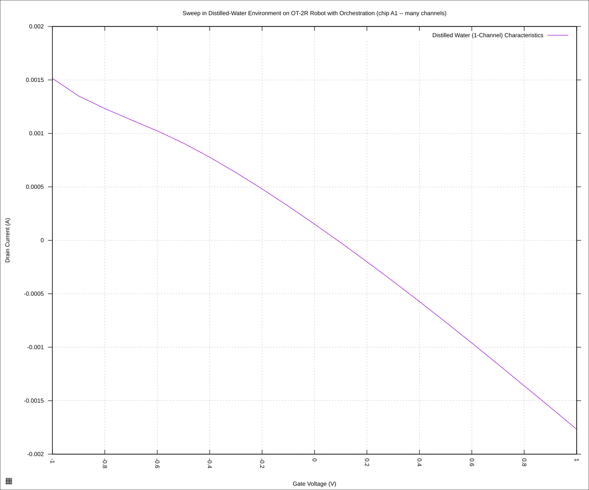
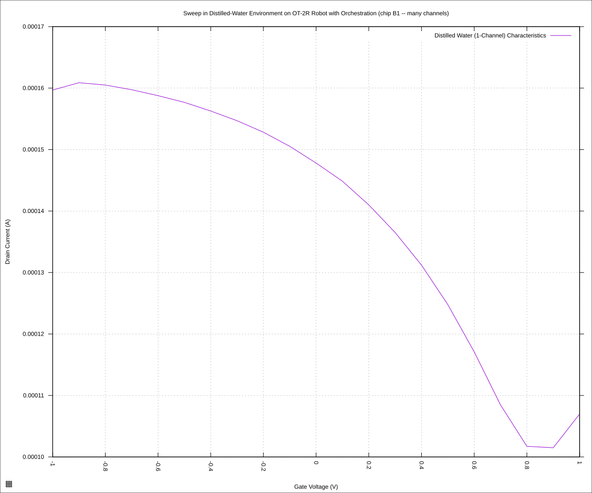

#+STARTUP: content
#+TITLE: Progress Report and Updates: 2026-10-30
#+AUTHOR: Frederick Muriuki Muriithi
#+PROPERTY: header-args:shell
#+LATEX_HEADER_EXTRA: \usepackage{svg}
#+BIBLIOGRAPHY: references.bib
#+CITE_EXPORT: natbib kluwer
#+LATEX_HEADER_EXTRA: \usepackage{fontspec}
#+LATEX: \setmainfont{Liberation Serif}
#+AUTO_TANGLE: t
#+OPTIONS: ^:{}

* Integrations

Since 2026-10-08 to 2026-10-29, work has been done towards getting some
orchestration of the various devices. Some work was done towards generalising
the code to any process, but this was out of the scope of the current project,
thus, focus was narrowed towards generating a script that does the orchestration
for the specific case we attempting to run.

Commit [[https://github.com/livingcodeslab/gfet-microfluidics-experiments/commit/8052fab5dfce70fca9abd54ed08a3ad0b0776cba][8052fab5]] introduces the final form of the script. This was run on
2026-10-29 and data collected. We begin the day by processing the data that was
generated, to see whether it approximates what we expect.

Process the raw data to separate positive values from negative ones:

#+begin_src shell
  python3 isswisafre.py process-data \
          "sweeps/20261029-chip-A1-np3x7r.csv" \
          "sweeps/"
  python3 isswisafre.py process-data \
          "sweeps/20261029-chip-B1-bmk9jf.csv" \
          "sweeps/"
#+end_src

and now, the plots can be generated:

#+begin_src gnuplot :tangle ./20261029-chip-A1-np3x7r.gp
  load "./20260220-plotting-styles.gp"

  set output "./static/20261029-chip-A1-np3x7r.svg"

  set title "Sweep in Distilled-Water Environment on OT-2R Robot with Orchestration (chip A1 -- many channels)"
  set xlabel "Gate Voltage (V)"
  set ylabel "Drain Current (A)"
  set datafile separator ","
  plot \
       "./static/20261029-chip-A1-np3x7r-positive.csv" \
       using "measured_gate_voltage":"drain_current" \
       title "Distilled Water (1-Channel) Characteristics" \
       with lines
#+end_src

#+CAPTION: Sweep in Distilled-Water Environment on OT-2R Robot with Orchestration (chip A1 -- many channels)
#+NAME: 20261029-chip-A1-np3x7r

#+begin_src gnuplot :tangle ./20261029-chip-B1-bmk9jf.gp
  load "./20260220-plotting-styles.gp"

  set output "./static/20261029-chip-B1-bmk9jf.svg"

  set title "Sweep in Distilled-Water Environment on OT-2R Robot with Orchestration (chip B1 -- many channels)"
  set xlabel "Gate Voltage (V)"
  set ylabel "Drain Current (A)"
  set datafile separator ","
  plot \
       "./static/20261029-chip-B1-bmk9jf-positive.csv" \
       using "measured_gate_voltage":"drain_current" \
       title "Distilled Water (1-Channel) Characteristics" \
       with lines
#+end_src

#+CAPTION: Sweep in Distilled-Water Environment on OT-2R Robot with Orchestration (chip B1 -- many channels)
#+NAME: 20261029-chip-B1-bmk9jf

The [[20261029-chip-A1-np3x7r][first plot]] starts with the downward-trending curve, as expected, but does
not bottom out and turn back up. This might be caused by the fact that the chips
had been left exposed to the air for a number of days before being used in this
experiment.

The [[20261029-chip-B1-bmk9jf][second plot]] does bottom out, but not in a nice clean curve as we have
previously seen. It does make sense, however, seeing as we use 50Hz for the line
frequency in the script (should be 60Hz) and a NPLC of 1 (we usually use an NPLC
of 12.5005): both these values determine the integration time for the
measurements taken. With the values used in the script,  there is barely any
intergration run, therefore the measurement values are not quite as accurate as
they could get.

These two plots, despite their inaccuracies, indicate that using the robot is a
viable option.
