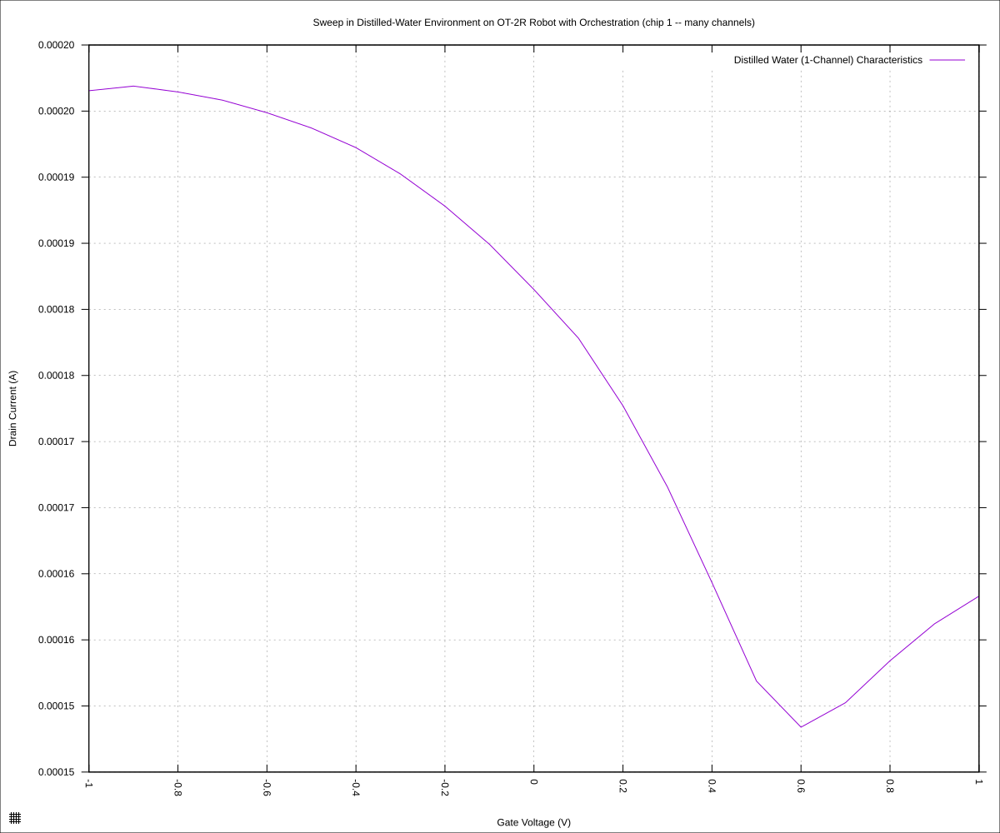
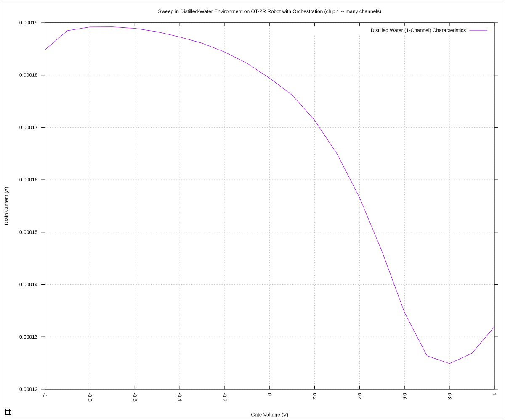
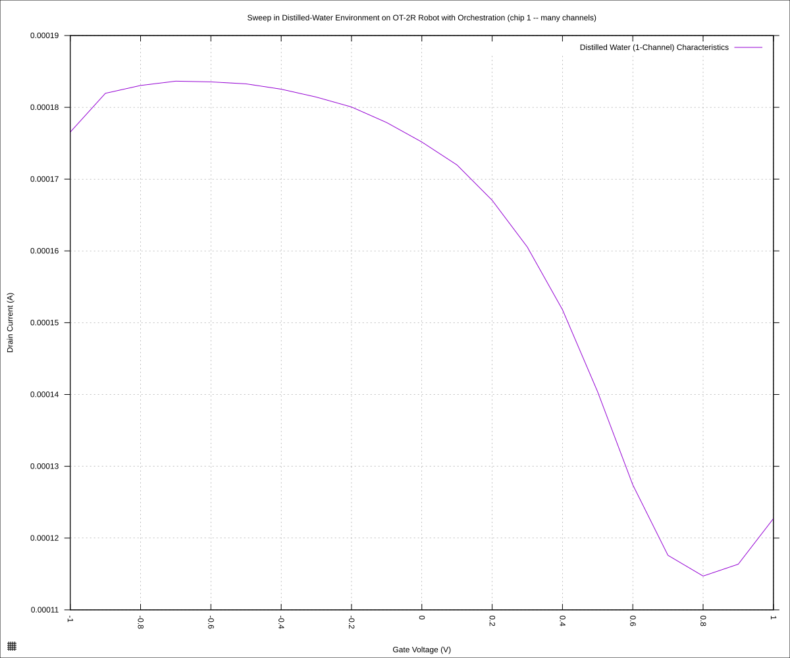
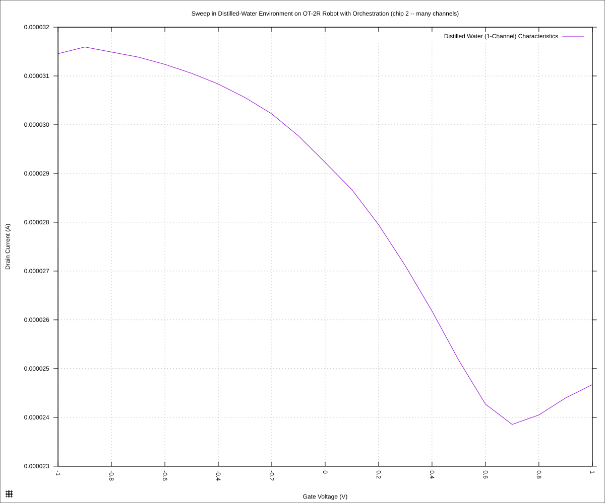
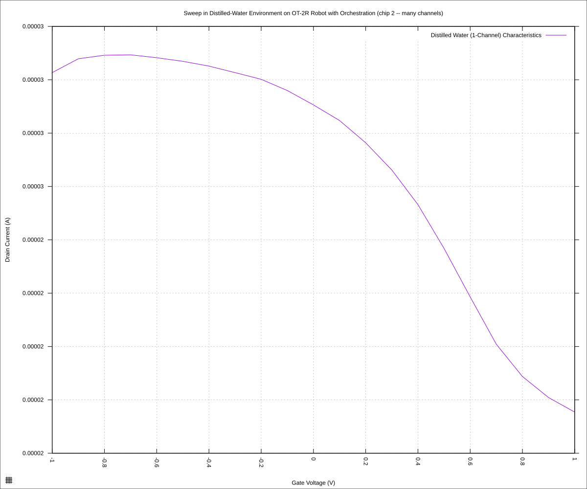
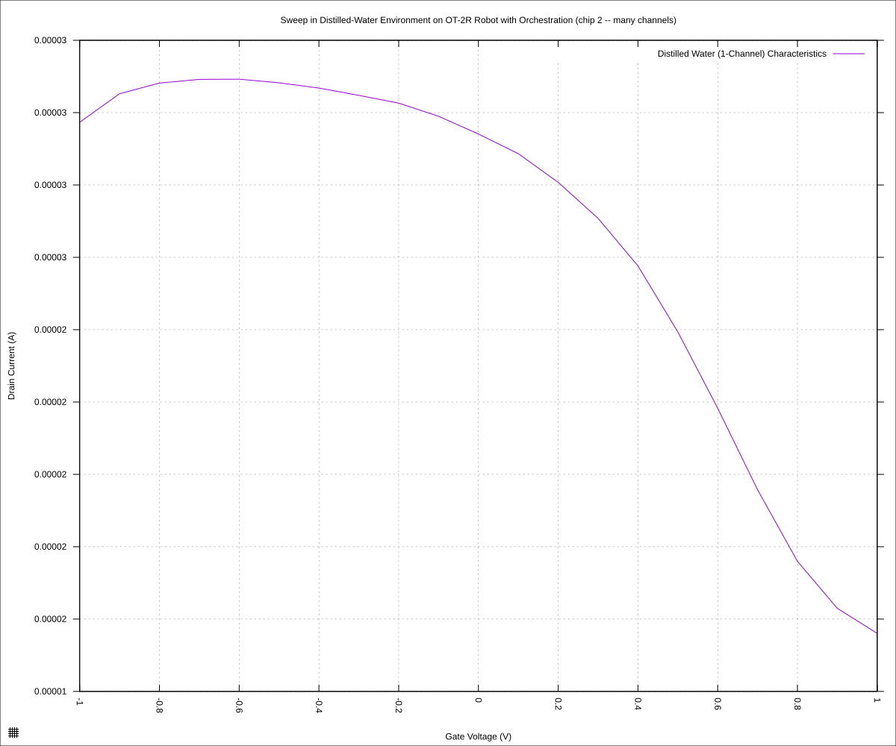

#+STARTUP: content
#+TITLE: Progress Report and Updates: 2026-11-02
#+AUTHOR: Frederick Muriuki Muriithi
#+PROPERTY: header-args:shell
#+LATEX_HEADER_EXTRA: \usepackage{svg}
#+BIBLIOGRAPHY: references.bib
#+CITE_EXPORT: natbib kluwer
#+LATEX_HEADER_EXTRA: \usepackage{fontspec}
#+LATEX: \setmainfont{Liberation Serif}
#+AUTO_TANGLE: t
#+OPTIONS: ^:{}

* Integrations

Completed [[https://github.com/livingcodeslab/gfet-microfluidics-experiments/commit/e19c961bf392c3a39b5952c369e37a50709ff5b9][the script]] with 3 reagents:

- Distilled water
- 0.001X PBS
- 0.0005X PBS

Ran the script, and the script was mostly successful.

A few things of note:

- The tips seem to seal against the chip, if the chip is not recessed somewhat into the socket
- I had left all the switches for chip 2 (B1) in the ON position, so the
  readings for chip 1 (A1) might be full of noise.
- The script seems to freeze in the =8. Waiting for the run to finish= step.
  This might be fixed in the committed iteration.

** Data Analysis

The protocol was run, orchestrating the robot, SMU and multiplexer (me, in this
case). The results are as follows:

#+begin_src shell
  python3 isswisafre.py process-data \
          "sweeps/20261102-chip-1-water-jsnoly.csv" \
          "sweeps/"
  python3 isswisafre.py process-data \
          "sweeps/20261102-chip-1-0p0005PBS-jsnoly.csv" \
          "sweeps/"
  python3 isswisafre.py process-data \
          "sweeps/20261102-chip-1-00p1PBS-jsnoly.csv" \
          "sweeps/"
  python3 isswisafre.py process-data \
          "sweeps/20261102-chip-2-water-jsnoly.csv" \
          "sweeps/"
  python3 isswisafre.py process-data \
          "sweeps/20261102-chip-2-0p0005PBS-jsnoly.csv" \
          "sweeps/"
  python3 isswisafre.py process-data \
          "sweeps/20261102-chip-2-00p1PBS-jsnoly.csv" \
          "sweeps/"
#+end_src

thus now we can generate the plots.

#+begin_src shell
  randstr='jsnoly'
  date='20261102'

  for chip in "1" "2"
  do
      for reagent in "water" "0p0005PBS" "0p001PBS"
      do        
          gnuplot << EOF
  load "./20260220-plotting-styles.gp"

  set output "./static/${date}-chip-${chip}-${reagent}-${randstr}.svg"

  set title "Sweep in Distilled-Water Environment on OT-2R Robot with Orchestration (chip ${chip} -- many channels)"
  set xlabel "Gate Voltage (V)"
  set ylabel "Drain Current (A)"
  set datafile separator ","
  plot \
      "./static/${date}-chip-${chip}-${reagent}-${randstr}-positive.csv" \
      using "measured_gate_voltage":"drain_current" \
      title "Distilled Water (1-Channel) Characteristics" \
      with lines
  EOF
      done
  done
#+end_src

We get the following plots:

*** Chip 01 (A1)

The dirac point, for water on chip 1, occurs at a gate voltage of around 0.6V
and a drain current of around 150µA

#+CAPTION: Distilled water on Chip 1 (A1)
#+NAME: 20261102-chip-1-water-jsnoly

The dirac point, for 0.0005X PBS occurs at a gate voltage of around 0.8V
and a drain current of around 130µA

#+CAPTION: 0.0005X PBS on Chip 1 (A1)
#+NAME: 20261102-chip-1-0p0005PBS-jsnoly

The dirac point, for 0.001X PBS occurs at a gate voltage of around 0.8V
and a drain current of around 120µA

#+CAPTION: 0.001X PBS on Chip 1 (A1)
#+NAME: 20261102-chip-1-0p001PBS-jsnoly

*** Chip 02 (B1)

The dirac point, for water on chip 2, occurs at a gate voltage of around 0.7V
and a drain current of around 24µA

#+CAPTION: Distilled water on Chip 2 (B1)
#+NAME: 20261102-chip-2-water-jsnoly

The dirac point, for 0.0005X PBS on chip 2, occurs beyond 1V gate current.

#+CAPTION: 0.0005X PBS on Chip 2 (B1)
#+NAME: 20261102-chip-2-0p0005PBS-jsnoly

The dirac point, for 0.0005X PBS on chip 2, occurs beyond 1V gate current.

#+CAPTION: 0.001X PBS on Chip 2 (B1)
#+NAME: 20261102-chip-2-0p001PBS-jsnoly

** Conclusions

This run clearly shows that it is indeed possible to run use the robot and SMU
with different reagents and sense the differences.

The script for this run was even more complex, doing dilutions first, in order
to acquire the appropriate concentrations for the reagents in question.

The biggest weakness to this is the fact that it relies on a human to switch
from one chip to the other: Building a controllable multiplexer circuit should
help ameliorate this final weakness.
