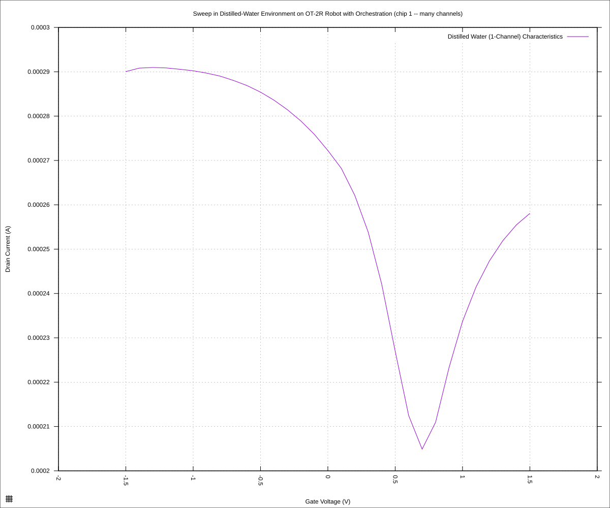
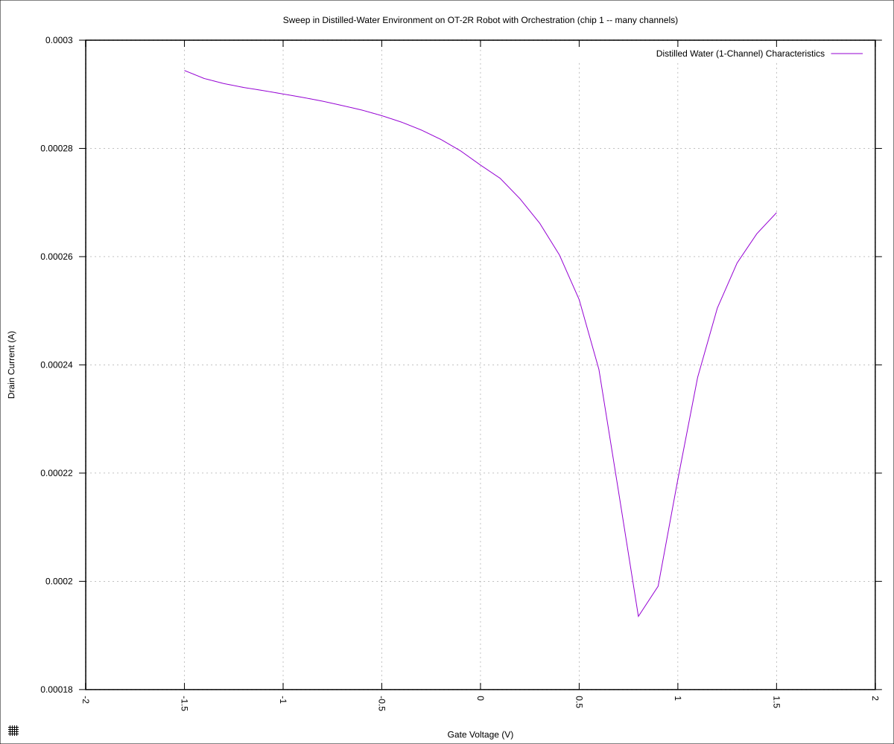
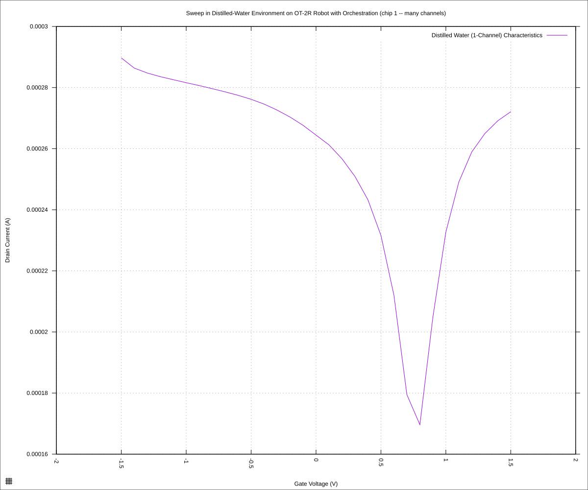
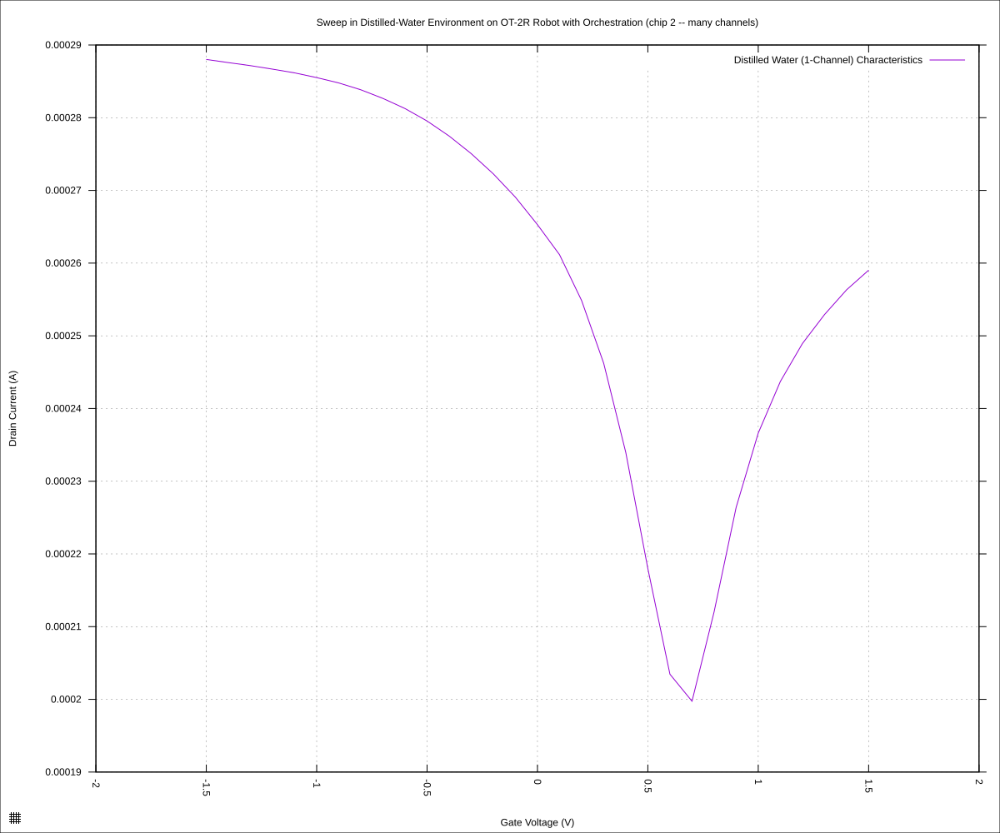
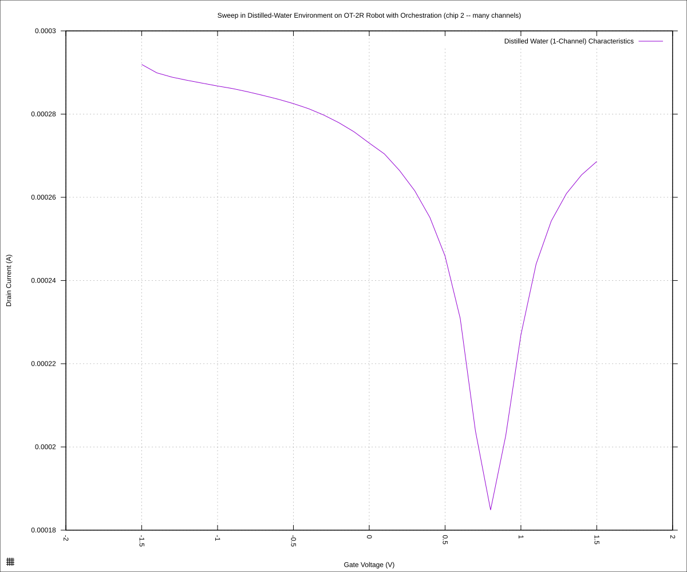
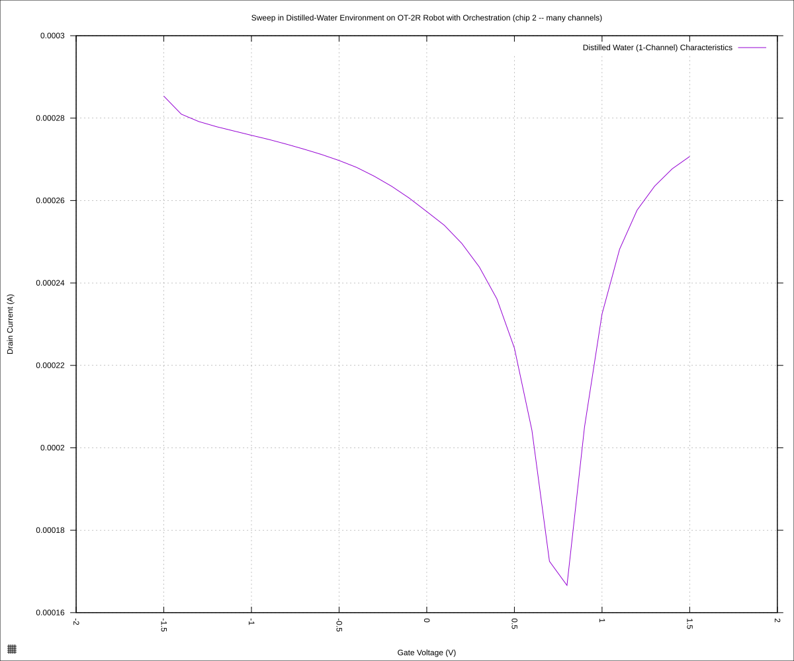

#+STARTUP: content
#+TITLE: Progress Report and Updates: 2026-11-03
#+AUTHOR: Frederick Muriuki Muriithi
#+PROPERTY: header-args:shell
#+LATEX_HEADER_EXTRA: \usepackage{svg}
#+BIBLIOGRAPHY: references.bib
#+CITE_EXPORT: natbib kluwer
#+LATEX_HEADER_EXTRA: \usepackage{fontspec}
#+LATEX: \setmainfont{Liberation Serif}
#+AUTO_TANGLE: t
#+OPTIONS: ^:{}

* Integration

The day began by fixing some minor bugs and issues encountered when running the
script yesterday.

After that, we increased the NPLC from 6.75025 to 12.5005 and re-ran the
experiment in order to get more accuracy in the data.

#+begin_src shell
  $ python3 workflow_gfet_smu_dilutions.py                           
1. Pre-flight: robot
2. Pre-flight: SMU
2026-11-03 16:59:06,541 - 1793725146.541782 - gdnasynth.keithley - INFO — Keithley 2602B SMU Serial Number: 4616013
2026-11-03 16:59:37,352 - 1793725177.352139 - gdnasynth.keithley - INFO — === Device stabilisation ===
2026-11-03 16:59:41,734 - 1793725181.734528 - gdnasynth.keithley - INFO — ============================
    run: ce2309cc-8262-41cc-a99f-822881caf99c
3. Diluting 1X PBS
    A1 -> A2 (1 x 18.0 uL)
    A2 -> A3 (1 x 18.0 uL)
    A3 -> A4 (1 x 18.0 uL)
    A4 -> A5 (5 x 18.0 uL)
4. Running the dilutions
    dilutions complete
5. Generating file suffix: toqop7
6. Transfer to 1 (A1) / water
    starting the run
7. Waiting for the pause at 1 / water
  multiplexer: connect the SMU to chip 1, then press Enter: 
    saved 62 readings to sweeps/20261103-chip-1-water-toqop7.csv
    removing the drop
    washing the chip
    queueing 1 / 0p0005PBS
7. Waiting for the pause at 1 / 0p0005PBS
    saved 62 readings to sweeps/20261103-chip-1-0p0005PBS-toqop7.csv
    removing the drop
    washing the chip
    queueing 1 / 00p1PBS
7. Waiting for the pause at 1 / 00p1PBS
    saved 62 readings to sweeps/20261103-chip-1-00p1PBS-toqop7.csv
    removing the drop
    washing the chip
    queueing 2 / water
7. Waiting for the pause at 2 / water
  multiplexer: connect the SMU to chip 2, then press Enter: 
    saved 62 readings to sweeps/20261103-chip-2-water-toqop7.csv
    removing the drop
    washing the chip
    queueing 2 / 0p0005PBS
7. Waiting for the pause at 2 / 0p0005PBS
    saved 62 readings to sweeps/20261103-chip-2-0p0005PBS-toqop7.csv
    removing the drop
    washing the chip
    queueing 2 / 00p1PBS
7. Waiting for the pause at 2 / 00p1PBS
    saved 62 readings to sweeps/20261103-chip-2-00p1PBS-toqop7.csv
    removing the drop
    washing the chip
    homing the robot
8. Waiting for the run to finish
9. Cleaning up the run
    final status: EngineStatus.SUCCEEDED
Reset: robot
Reset: SMU
workflow complete
files written:
    sweeps/20261103-chip-1-water-toqop7.csv
    sweeps/20261103-chip-1-0p0005PBS-toqop7.csv
    sweeps/20261103-chip-1-0p001PBS-toqop7.csv
    sweeps/20261103-chip-2-water-toqop7.csv
    sweeps/20261103-chip-2-0p0005PBS-toqop7.csv
    sweeps/20261103-chip-2-0p001PBS-toqop7.csv
#+end_src

With that, we can now generate the plots:

#+begin_src shell
  randstr='toqop7'
  date='20261103'

  for chip in "1" "2"
  do
      for reagent in "water" "0p0005PBS" "0p001PBS"
      do
          python3 isswisafre.py process-data \
                  "sweeps/${date}-chip-${chip}-${reagent}-${randstr}.csv" \
                  "sweeps/" && gnuplot << EOF
  load "./20260220-plotting-styles.gp"

  set output "./sweeps/${date}-chip-${chip}-${reagent}-${randstr}.svg"

  set title "Sweep in Distilled-Water Environment on OT-2R Robot with Orchestration (chip ${chip} -- many channels)"
  set xlabel "Gate Voltage (V)"
  set ylabel "Drain Current (A)"
  set datafile separator ","
  plot \
      "./sweeps/${date}-chip-${chip}-${reagent}-${randstr}-positive.csv" \
      using "measured_gate_voltage":"drain_current" \
      title "Distilled Water (1-Channel) Characteristics" \
      with lines
  EOF
      done
  done
#+end_src

** Results

*** Chip 1

#+CAPTION: Distilled water on Chip 1 (A1)
#+NAME: 20261103-chip-1-water-toqop7

The dirac point for water was found at approximately 0.75V gate voltage with a
drain current of around 250µA.

#+CAPTION: 0.0005X PBS on Chip 1 (A1)
#+NAME: 20261103-chip-1-0p0005PBS-toqop7

The dirac point for 0.0005X PBS was found at approximately 0.8V gate voltage
with a drain current of about 195µA.

#+CAPTION: 0.001X PBS on Chip 1 (A1)
#+NAME: 20261103-chip-1-0p001PBS-toqop7

The dirac point for 0.001X PBS was found at approximately 0.8V gate voltage
with a drain current of about 170µA.

*** chip 2

#+CAPTION: Distilled water on chip 2 (B1)
#+NAME: 20261103-chip-2-water-toqop7

The dirac point for water was found at approximately 0.65V gate voltage with a
drain current of around 200µA.

#+CAPTION: 0.0005X PBS on chip 2 (B1)
#+NAME: 20261103-chip-2-0p0005PBS-toqop7

The dirac point for 0.0005X PBS was found at approximately 0.8V gate voltage
with a drain current of about 185µA.

#+CAPTION: 0.001X PBS on chip 2 (B1)
#+NAME: 20261103-chip-2-0p001PBS-toqop7

The dirac point for 0.001X PBS was found at approximately 0.8V gate voltage
with a drain current of about 170µA.

** Conclusions

This experiment further illustrates that it is viable to use orchestration
scripts to automate and perform experiment on graphene chips using the OT-2
robot and the SMU for data acquisition.

In (a) future iteration(s), we should probably increase the resolution of the
readings from a step of 0.1V to 0.01V to get smoother curves.
